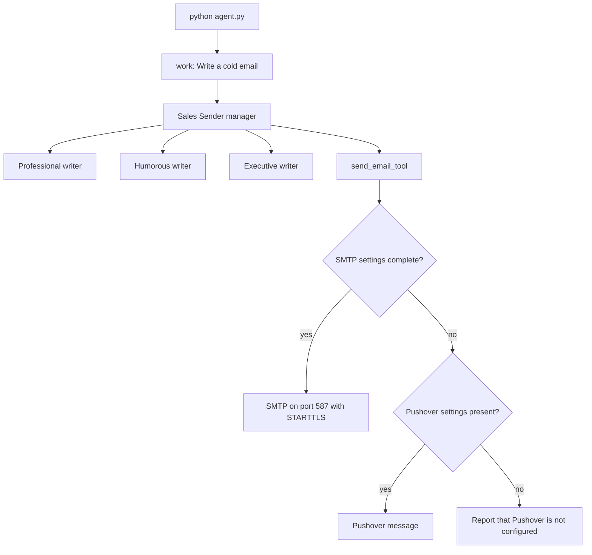

# Sales Agent

An AI sales workflow for [ComplAI](https://github.com/rishabh-2410/sales-agent), a SaaS product that helps teams prepare for SOC 2 audits. The program drafts a cold sales email in three voices, picks one, and delivers that one message.

## Project Overview

`sales-agent` is a small Python program. It does not run a web server and it does not store customers. One run asks a sales manager agent to collect three drafts, choose the strongest draft, and send only that draft.

The product voice in the prompts is ComplAI: an AI tool for SOC 2 compliance and audit preparation. The entrypoint is `agent.py`. Running it starts the task "Write a cold email".

## Features

- Three writer agents, each with a fixed tone: professional, humorous, and executive.
- A sales manager that must call those writers, compare the drafts, and choose one.
- A single send step. The manager instructions say to send only the chosen email.
- Email delivery over SMTP when the mailbox settings are present.
- A Pushover notification when SMTP is not configured, so a run can still show the chosen message.

## Tech Stack

- Python
- [OpenAI Agents SDK](https://github.com/openai/openai-agents-python) (`openai-agents`)
- OpenAI models, set in code to `gpt-5.4-mini`
- `python-dotenv` for a local env file
- `requests` for the Pushover HTTP call
- The Python standard library `smtplib` for email

Dependencies are listed in `requirements.txt`.

## Architecture

The running path is one manager with four tools: three writers and one sender. The manager is configured with `tool_choice` set to `required`, so a reply that never calls a tool is not accepted.



### Draft and send flow

1. `work()` in `agent.py` starts a trace named "Sales manager" and runs the Sales Sender agent.
2. The manager calls `sales_email_writer_1`, `sales_email_writer_2`, and `sales_email_writer_3`.
3. Each writer uses the shared ComplAI prompt plus one style line from `context.py`.
4. The manager selects one draft and calls `send_email_tool` once.
5. `tools.py` sends mail when `EMAIL_ADDRESS`, `EMAIL_SMTP_SERVER`, and `EMAIL_APP_PASSWORD` are all set. Otherwise it posts the subject and plain-text body to Pushover.

The sender addresses the message to `EMAIL_ADDRESS`, the same mailbox it sends from. This run delivers a demo message to that mailbox. It does not read a prospect list.

## Local Setup

Use a current Python 3 and a virtual environment.

```bash
python -m venv .venv
source .venv/bin/activate
pip install -r requirements.txt
```

Create a `.env` file in the project directory. Names that contain `env` are ignored by `.gitignore`.

```bash
OPENAI_API_KEY=
EMAIL_ADDRESS=
EMAIL_SMTP_SERVER=
EMAIL_APP_PASSWORD=
PUSHOVER_USER=
PUSHOVER_TOKEN=
```

`agent.py` and `tools.py` call `load_dotenv()`. The OpenAI Agents SDK reads `OPENAI_API_KEY` from the environment. Email is used only when all three `EMAIL_*` variables are set. Pushover is used only when email is not configured and both `PUSHOVER_USER` and `PUSHOVER_TOKEN` are set.

Run the agent:

```bash
python agent.py
```

The result of a successful run is the email or the Pushover notification. `work()` does not print the draft.

### Environment variables

| Variable | Required | Purpose |
| --- | --- | --- |
| `OPENAI_API_KEY` | Yes | Authenticates model calls for the writers and the manager. |
| `EMAIL_ADDRESS` | For email | SMTP username, From address, and To address. |
| `EMAIL_SMTP_SERVER` | For email | SMTP hostname. The client connects on port 587 and starts TLS. |
| `EMAIL_APP_PASSWORD` | For email | SMTP password. Use a mailbox app password. |
| `PUSHOVER_USER` | For the fallback | Pushover user key. |
| `PUSHOVER_TOKEN` | For the fallback | Pushover application token. |

## Database Design

This project has no database. A run keeps drafts in memory until the process exits.

## API Overview

There is no inbound HTTP API. The program makes outbound calls only.

| Call | When | What is sent |
| --- | --- | --- |
| OpenAI, through the Agents SDK | Every run | The task, writer instructions, and manager instructions. |
| SMTP `STARTTLS` on port 587 | All three `EMAIL_*` variables are set | Subject, plain-text body, and HTML body to `EMAIL_ADDRESS`. |
| `POST https://api.pushover.net/1/messages.json` | Email is not configured | Subject and plain-text body as the Pushover message. |

`send_email_tool` accepts `subject`, `text_body`, and `html_body`. The Pushover path sends the subject and `text_body` only.

## Security

- Keep secrets in the environment or in a local `.env` file. Do not commit that file. `.gitignore` ignores every name ending in `env`.
- `EMAIL_APP_PASSWORD`, `PUSHOVER_TOKEN`, `PUSHOVER_USER`, and `OPENAI_API_KEY` are credentials. Treat them as secrets.
- SMTP login happens after `STARTTLS` on port 587.
- When email is configured, a run sends a real message. The recipient is the configured `EMAIL_ADDRESS`.
- The Pushover token identifies the application. Anyone with that token and the user key can send notifications to that user.

## Design Decisions

- The three tones are separate agents, not one prompt with a style argument. The manager compares finished drafts.
- The manager's `tool_choice` is `required`. It cannot answer with prose and skip the tools.
- The manager instructions require all three drafts before a choice, and they allow only one send.
- Writer instructions live in `context.py`. Delivery lives in `tools.py`. Wiring lives in `agent.py`.
- Delivery prefers SMTP and falls back to Pushover so the same tool works without a mailbox.

## Optimizations

The live path does not run the three writers concurrently. The manager calls them as tools, one decision at a time.

`agent.py` still contains a commented `asyncio.gather` over the three writers. That version is not what `python agent.py` runs. The live design trades that parallelism for a manager that both writes and sends under one tool policy.

`tool_choice` set to `required` also avoids a wasted model reply that forgets to draft or send.

## Deployment

There is no Dockerfile, process manager, or hosted app config in this repository. Run it as a local Python process with the environment variables above available to that process.

A hosted run needs the same variables in the host environment. Do not bake the `.env` file into an image. The process exits when the manager run finishes, so a scheduler or a one-off job is enough. There is no port to expose.

## Lessons Learned

- Forcing tool use matters. Without `tool_choice="required"`, the manager can describe an email and never send it.
- A fallback channel keeps the demo usable. Missing SMTP settings should not be the only way a run fails.
- Sending to the operator's own address is the right default for a demo. A prospect list would be a separate, explicit step.
- Splitting prompts, tools, and the agent graph makes the tone and the delivery path easy to read. The commented parallel path is a reminder that generation and selection used to be separate steps.

## License

MIT License. Copyright (c) 2026 Rishabh Sharma. See [LICENSE](LICENSE).
